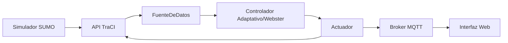

# SmartJunction-SUMO 🚦

Sistema de simulación y control adaptativo de semáforos para la optimización del flujo vehicular en el corredor Avenida Guaimaral - Avenida Libertadores en Cúcuta, Colombia.

Este proyecto implementa un sistema de control inteligente que ajusta los tiempos de verde basándose en la demanda real de tráfico, comparando el rendimiento contra esquemas de tiempo fijo y el método matemático de Webster.

## 🚀 Funcionalidades Principales

### 🧠 Algoritmos de Control
- **Control Adaptativo**: Ajuste heurístico en tiempo real basado en la longitud de las colas y el tiempo de espera de los vehículos.
- **Plan de Webster (B2)**: Implementación de la fórmula de ciclo óptimo para minimizar el retraso promedio.
- **Control de Tiempo Fijo**: Línea base con tiempos predefinidos para comparación de rendimiento.

### 🛡️ Seguridad y Resiliencia
- **Monitor de Seguridad (B1)**: Verificación constante de estados legales para evitar colisiones y asegurar fases de transición (amarillo/todo-rojo).
- **Modo Respaldo (B5)**: Detección de fallas en sensores; el sistema revierte automáticamente a un plan fijo seguro ante la pérdida de datos.

### 🏗️ Arquitectura de Integración
- **Capa de Abstracción (B8)**: Interfaces `FuenteDeDatos` y `Actuador` que desacoplan la lógica de control del simulador.
- **Integración MQTT (B10)**: Comunicación mediante el protocolo MQTT (Mosquitto) para simular la telemetría y el control remoto de las intersecciones.
- **Sensores E2 (B3)**: Uso de detectores de área en SUMO para simular sensores reales de pavimento.

### 💻 Interfaz de Monitoreo
- Dashboard web desarrollado en HTML/JS/Canvas que permite:
    - Visualizar el mapa de la red y el estado de los semáforos en tiempo real.
    - Comparar métricas (espera promedio, colas) entre los diferentes modos de control.
    - Monitorear el flujo de mensajes MQTT y los eventos de seguridad.

## 📐 Arquitectura del Sistema



## 🛠️ Instalación y Ejecución

### Requisitos
- **Python 3.x**
- **SUMO** (Simulation of Urban MObility)
- **Mosquitto** (MQTT Broker)

### Configuración
1. Clonar el repositorio.
2. Instalar dependencias:
   ```bash
   pip install -r requimientos.txt
   ```

### Flujo de Ejecución
1. **Iniciar el Broker MQTT**:
   Asegúrese de que Mosquitto esté corriendo en su sistema.
2. **Correr Simulaciones**:
   Puede ejecutar el controlador para un escenario y modo específicos:
   ```bash
   python src/control_export.py --escenario alto --modo adaptativo --fuente detectores
   ```
3. **Generar Datos para la Interfaz**:
   Una vez terminadas las corridas, procese los resultados para la web:
   ```bash
   python src/combinar_datos.py
   ```
4. **Abrir la Interfaz**:
   Abra el archivo `interfaz/index.html` en cualquier navegador moderno.

## 📁 Estructura del Proyecto

```text
.
├── config/               # Configuraciones del sistema
├── data/                 # Escenarios y resultados de simulación
├── interfaz/             # Dashboard web (HTML, JS, CSS)
├── src/                  # Código fuente en Python
│   ├── control_export.py     # Lógica de control y orquestador
│   ├── capa_integracion.py   # Abstracciones B8
│   ├── monitor_seguridad.py  # B1 - Validación de estados
│   ├── nodo_mqtt.py          # B10 - Comunicación MQTT
│   └── combinar_datos.py     # Procesador de datos para la interfaz
└── sumo/                 # Archivos de red y configuración de SUMO
```

## 📊 Métricas de Evaluación
El sistema evalúa el éxito de las estrategias basándose en:
- **Espera promedio por vehículo**: Tiempo total de retraso.
- **Longitud de cola**: Número de vehículos detenidos por carril.
- **Vehículos completados**: Cantidad de viajes finalizados con éxito.
